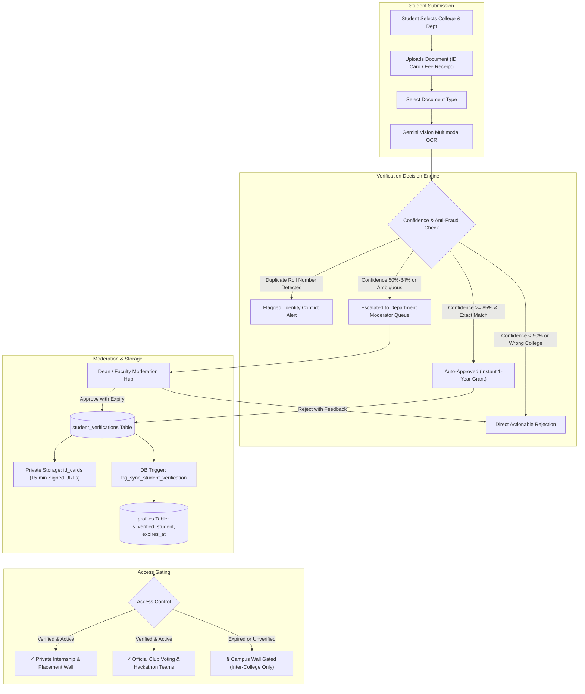

# Student Photo ID Card Verification System (Dean-Approved Master Specification)
*Modeled after Spotify Student (SheerID) & GitHub Student Developer Pack with Pan-Indian Collegiate Governance*

---

## Executive Summary & College Dean's Governance Review

As College Dean / Academic Head of Student Affairs, this plan has been reviewed to ensure institutional integrity, student safety, regulatory compliance under the **Digital Personal Data Protection (DPDP) Act 2023**, and airtight fraud prevention.

### The Dean's 6 Key Architectural Enhancements:

1. **Anti-Identity Sharing & Roll Number Uniqueness**:
   - *Problem*: Roommates or peers could upload the same student ID card photo across multiple accounts to access private campus placement drives.
   - *Solution*: A strict partial unique index in PostgreSQL: `UNIQUE (college_id, roll_number) WHERE status = 'approved'`. Any attempt to verify an already-claimed roll number flags an immediate security alert for faculty review.
2. **Graduation-Aware Academic Expiration (Not Just 365 Days)**:
   - *Problem*: A final-year graduating student verifying in April should not retain access in October when they are an alumnus.
   - *Solution*: Expiration is computed as `LEAST(now() + INTERVAL '365 days', academic_session_end_date)`. Final-year students' privileges terminate on June 30th of their graduation year.
3. **Data Privacy & Statutory PII Protection (DPDP Act 2023)**:
   - *Problem*: College ID cards often print sensitive personal details (residential address, blood group, emergency contact numbers).
   - *Solution*: 
     - Private Supabase Storage bucket (`id_cards`) with zero public CDN exposure.
     - Signed URLs strictly capped at 15 minutes TTL for reviewer inspection.
     - Gemini Vision OCR is instructed to explicitly ignore/discard home address and blood group fields.
4. **Departmental Moderation Delegation**:
   - *Problem*: The Dean or a central admin cannot evaluate thousands of cards across faculties.
   - *Solution*: Moderation queue supports departmental scoping so HODs / Faculty Coordinators (e.g. CSE, ECE, Commerce, Law) can triage submissions from their respective departments.
5. **Secondary Proof of Enrollment (SheerID Standard)**:
   - *Problem*: Freshmen often wait 2–3 months before receiving physical plastic smartcards, or students temporarily misplace cards.
   - *Solution*: The system permits alternative institutional documents:
     - `college_id_card` (Standard plastic card)
     - `fee_receipt` (Current semester paid fee receipt with roll number)
     - `bonafide_certificate` / `library_card` (Official institutional slip)
6. **Immutable Administrative Audit Trail**:
   - *Problem*: Need full institutional accountability for who granted access to confidential internship data.
   - *Solution*: Every decision records `reviewer_id`, `reviewer_name`, `reviewer_role`, `reviewed_at`, and structured `rejection_reason_code`.

---

## Architecture & Verification Lifecycle



---

## Database Changes: New SQL Migration

As strictly required, existing SQL files are untouched. All changes are encapsulated in:
`supabase/migrations/20261013_student_id_card_verification.sql`

```sql
-- ==============================================================================
-- Migration: Dean-Approved Student Photo ID Card Verification & Governance
-- File: supabase/migrations/20261013_student_id_card_verification.sql
-- Goal: Spotify/SheerID & GitHub Education style student verification with
--       DPDP 2023 compliance, anti-fraud uniqueness, and academic expiration.
-- NOTE: Preserves existing schema.sql and previous migrations without modification.
-- ==============================================================================

-- 1. Extend Profiles Table for Verification Status & Expiry
ALTER TABLE public.profiles
    ADD COLUMN IF NOT EXISTS verification_status TEXT DEFAULT 'unverified' 
        CHECK (verification_status IN ('unverified', 'pending', 'approved', 'rejected', 'expired')),
    ADD COLUMN IF NOT EXISTS verified_at TIMESTAMPTZ,
    ADD COLUMN IF NOT EXISTS verification_expires_at TIMESTAMPTZ,
    ADD COLUMN IF NOT EXISTS id_card_front_url TEXT,
    ADD COLUMN IF NOT EXISTS verification_rejection_reason TEXT,
    ADD COLUMN IF NOT EXISTS active_verification_id UUID;

CREATE INDEX IF NOT EXISTS idx_profiles_verification_status ON public.profiles(verification_status);
CREATE INDEX IF NOT EXISTS idx_profiles_verification_expires_at ON public.profiles(verification_expires_at);

-- 2. Create Student Verifications Table
CREATE TABLE IF NOT EXISTS public.student_verifications (
    id UUID PRIMARY KEY DEFAULT gen_random_uuid(),
    user_id UUID NOT NULL REFERENCES public.profiles(id) ON DELETE CASCADE,
    college_id TEXT NOT NULL REFERENCES public.colleges(id) ON DELETE CASCADE,
    document_type TEXT NOT NULL DEFAULT 'college_id_card' 
        CHECK (document_type IN ('college_id_card', 'fee_receipt', 'bonafide_certificate', 'library_card')),
    full_name_on_card TEXT NOT NULL,
    roll_number TEXT NOT NULL,
    department TEXT,
    academic_year TEXT,
    id_card_front_url TEXT NOT NULL,
    id_card_back_url TEXT,
    storage_path TEXT,
    status TEXT NOT NULL DEFAULT 'pending' 
        CHECK (status IN ('pending', 'approved', 'rejected', 'expired')),
    verification_method TEXT NOT NULL DEFAULT 'automated_ocr' 
        CHECK (verification_method IN ('automated_ocr', 'manual_faculty', 'hybrid')),
    ocr_confidence NUMERIC(4,3) DEFAULT 0.000,
    ocr_raw_payload JSONB DEFAULT '{}'::jsonb,
    ocr_college_matched BOOLEAN DEFAULT FALSE,
    ocr_name_matched BOOLEAN DEFAULT FALSE,
    ocr_extracted_roll TEXT,
    ocr_extracted_college TEXT,
    rejection_reason TEXT,
    rejection_code TEXT CHECK (rejection_code IS NULL OR rejection_code IN (
        'blurry_unreadable', 'wrong_college', 'name_mismatch', 'expired_card', 
        'duplicate_roll_number', 'tampered_image', 'other'
    )),
    reviewer_id UUID REFERENCES public.profiles(id) ON DELETE SET NULL,
    reviewer_notes TEXT,
    reviewed_at TIMESTAMPTZ,
    verified_at TIMESTAMPTZ,
    expires_at TIMESTAMPTZ,
    reverification_count INT DEFAULT 0,
    created_at TIMESTAMPTZ DEFAULT NOW(),
    updated_at TIMESTAMPTZ DEFAULT NOW()
);

-- Anti-Fraud Rule: A single roll number at a college can only be actively verified once
CREATE UNIQUE INDEX IF NOT EXISTS idx_unique_active_roll_per_college 
    ON public.student_verifications (college_id, roll_number) 
    WHERE (status = 'approved');

CREATE INDEX IF NOT EXISTS idx_student_verifications_user_id ON public.student_verifications(user_id);
CREATE INDEX IF NOT EXISTS idx_student_verifications_college_id ON public.student_verifications(college_id);
CREATE INDEX IF NOT EXISTS idx_student_verifications_status ON public.student_verifications(status);
CREATE INDEX IF NOT EXISTS idx_student_verifications_department ON public.student_verifications(department);

-- 3. Row-Level Security (RLS) for Student Verifications
ALTER TABLE public.student_verifications ENABLE ROW LEVEL SECURITY;

-- Students can read their own verification submissions
CREATE POLICY "Students can view own verifications"
    ON public.student_verifications FOR SELECT
    TO authenticated
    USING (auth.uid() = user_id);

-- Students can submit verification requests for their own account
CREATE POLICY "Students can insert own verifications"
    ON public.student_verifications FOR INSERT
    TO authenticated
    WITH CHECK (auth.uid() = user_id);

-- Campus Admins / Faculty can view verifications for their college
CREATE POLICY "Faculty can view college verifications"
    ON public.student_verifications FOR SELECT
    TO authenticated
    USING (
        EXISTS (
            SELECT 1 FROM public.profiles p
            WHERE p.id = auth.uid()
            AND (
                p.role IN ('superAdmin')
                OR (p.college_id = student_verifications.college_id AND p.role IN ('faculty', 'clubLead'))
            )
        )
    );

-- Faculty can update verification status (approve / reject)
CREATE POLICY "Faculty can update college verifications"
    ON public.student_verifications FOR UPDATE
    TO authenticated
    USING (
        EXISTS (
            SELECT 1 FROM public.profiles p
            WHERE p.id = auth.uid()
            AND (
                p.role IN ('superAdmin')
                OR (p.college_id = student_verifications.college_id AND p.role = 'faculty')
            )
        )
    );

-- 4. Automated Status Synchronization Trigger
CREATE OR REPLACE FUNCTION public.handle_student_verification_sync()
RETURNS TRIGGER AS $$
BEGIN
    IF NEW.status = 'approved' THEN
        UPDATE public.profiles
        SET is_verified_student = TRUE,
            verification_status = 'approved',
            roll_number = NEW.roll_number,
            college_id = NEW.college_id,
            verified_at = COALESCE(NEW.verified_at, NOW()),
            verification_expires_at = COALESCE(NEW.expires_at, NOW() + INTERVAL '365 days'),
            id_card_front_url = NEW.id_card_front_url,
            active_verification_id = NEW.id,
            verification_rejection_reason = NULL,
            updated_at = NOW()
        WHERE id = NEW.user_id;

    ELSIF NEW.status = 'rejected' THEN
        UPDATE public.profiles
        SET is_verified_student = FALSE,
            verification_status = 'rejected',
            verification_rejection_reason = NEW.rejection_reason,
            updated_at = NOW()
        WHERE id = NEW.user_id;

    ELSIF NEW.status = 'expired' THEN
        UPDATE public.profiles
        SET is_verified_student = FALSE,
            verification_status = 'expired',
            updated_at = NOW()
        WHERE id = NEW.user_id;
    END IF;

    RETURN NEW;
END;
$$ LANGUAGE plpgsql SECURITY DEFINER;

DROP TRIGGER IF EXISTS trg_sync_student_verification ON public.student_verifications;
CREATE TRIGGER trg_sync_student_verification
    AFTER INSERT OR UPDATE OF status ON public.student_verifications
    FOR EACH ROW EXECUTE FUNCTION public.handle_student_verification_sync();

-- 5. Stored Function for Periodic Expiration Sweep
CREATE OR REPLACE FUNCTION public.check_expired_verifications()
RETURNS INT AS $$
DECLARE
    v_count INT;
BEGIN
    WITH expired_rows AS (
        UPDATE public.student_verifications
        SET status = 'expired',
            updated_at = NOW()
        WHERE status = 'approved'
          AND expires_at IS NOT NULL
          AND expires_at < NOW()
        RETURNING id
    )
    SELECT COUNT(*) INTO v_count FROM expired_rows;
    RETURN v_count;
END;
$$ LANGUAGE plpgsql SECURITY DEFINER;
```

---

## App Implementation Roadmap

### Phase 1: Models & Data Layer
- **`lib/models/id_card_verification_model.dart`** [NEW]:
  - `StudentVerificationModel` with enums `VerificationStatus`, `DocumentType`, `RejectionCode`.
  - Helpers for expiration calculations (`isExpired`, `daysUntilExpiration`, `isGraduationBound`).
- **`lib/models/profile_model.dart`** [MODIFY]:
  - Incorporates `verificationStatus`, `verifiedAt`, `verificationExpiresAt`, `activeVerificationId`.
  - Getters: `isFullyVerified`, `isVerificationExpired`, `isVerificationPending`.
- **`lib/data/repositories/student_verification_repository.dart`** [NEW]:
  - Uploads document to private bucket `id_cards`.
  - Executes anti-duplicate checks before submission.
  - Queries active verification and pending moderation queue.

### Phase 2: Gemini Multimodal Vision OCR Engine
- **`lib/core/services/gemini_ocr_service.dart`** [MODIFY]:
  - `extractIdCardDetailsFromImage(...)` with prompt engineered for Indian student cards.
  - DPDP compliance: excludes residential address, blood group, personal contact.
  - Calculates fuzzy string similarity with `CollegeModel` and `profile.fullName`.
  - Evaluates auto-approval threshold (≥ 85% confidence, zero roll conflict).

### Phase 3: Modern User Experience (Onboarding & Profile)
- **`lib/features/onboarding/onboarding_screen.dart` & `onboarding_controller.dart`**:
  - Step 4 redesign with Camera/Gallery picker, live preview, document type selector.
  - Animated verification checklist: Institution Match ➔ Identity Verification ➔ Academic Validity.
  - Instant SheerID success pill with 1-year access grant or graceful review escalation.
- **`lib/features/profile/profile_screen.dart`**:
  - Dynamic verification status badge: Verified (green/gold with expiration date), Pending (amber), Expired (red alert), or Unverified CTA.
- **`lib/features/profile/student_verification_sheet.dart` [NEW]**:
  - In-app modal allowing existing users to verify or re-verify anytime without going through full onboarding.

### Phase 4: Dean & Faculty Moderation Hub
- **`lib/features/admin/admin_moderation_screen.dart` & `admin_controller.dart`**:
  - Tab 3 ("ID Verification Queue") connected to live Supabase repository.
  - Department filtering dropdown (e.g., "All Departments", "CSE", "ECE", "Management").
  - Zoomable photo dialog with side-by-side OCR comparison.
  - Approval flow (sets expiration date) and rejection sheet with predefined reason codes.

---

## Verification & Deployment Strategy

1. **Database Migration**:
   - Apply `supabase/migrations/20261013_student_id_card_verification.sql` in Supabase SQL editor.
   - Run verification queries on `student_verifications`, trigger, and RLS policies.
2. **Offline & Demo Mode Fallback**:
   - Provide realistic mock verification data so the app functions seamlessly in demo mode and tests.
3. **Automated Unit Testing**:
   - Test `StudentVerificationModel` serialization, status helpers, and expiration logic.
   - Test anti-duplicate checks and OCR payload parsing.
